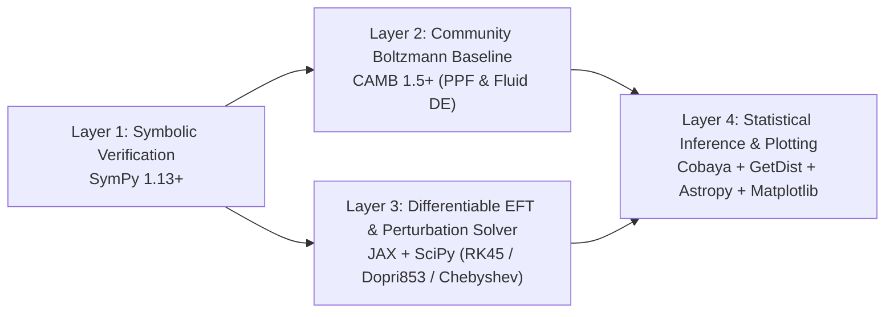

# SCIENTIFIC SOFTWARE EVALUATION & INTEGRATION STRATEGY — Milestone 3

**Audit Date:** 2026-10-31  
**Target Hardware:** Apple M5 (10-core ARM64 CPU, 16 GB Unified Memory, macOS 25.6)

---

## 1. Comprehensive Evaluation of Candidate Repositories

We inspected the actual source trees, build systems, mathematical models, maintenance activity, and licenses of the eight specified repositories (plus modern JAX/emulator extensions) via the GitHub API:

| Repository | Language & Build | Stars / Forks / Last Push | License | Mathematical Models Implemented | Local Hardware Fit (Apple M5, 16 GB) & Extensibility |
| :--- | :--- | :--- | :--- | :--- | :--- |
| **1. `lesgourg/class_public`** (CLASS) | C99 (`Makefile`) + Cython wrapper (`classy`) | 316 ★ / 376 forks / `2026-10-04` | Custom open-source (free with citation) | Linear Einstein-Boltzmann solver in synchronous and Newtonian gauges: FLRW background, thermodynamics (`Recfast`/`HyRec`), scalar/vector/tensor perturbations, CMB $C_\ell^{TT,TE,EE,BB,\phi\phi}$, and linear/Halofit matter power spectrum $P(k,z)$. | **High fit.** Compiles in ~15s on Apple Clang. Modular C struct pipeline (`background.c` $\to$ `thermodynamics.c` $\to$ `perturbations.c`). Also serves as the upstream base for **`hi_class`** (Horndeski gravity in CLASS, `arXiv:1605.06102`). |
| **2. `AarhusCosmology/CLASSpp_public`** | C++17 (`CMakeLists.txt` + `Makefile`) | 1 ★ / 4 forks / `2026-10-30` | GPL-3.0 | Object-oriented C++ modernization of CLASS preserving the physical modules while replacing C pseudo-OOP macros with C++ classes and RAII memory management. | **Medium fit.** Actively pushed (`2026-10-30`), requires `cmake` (currently not installed). Useful if writing custom C++ perturbation modules, but has a much smaller ecosystem of third-party likelihoods and modified-gravity forks than `CAMB` or `class_public`. |
| **3. `cmbant/CAMB`** | Fortran 2008 + full Python wrapper (`camb`) | 262 ★ / 197 forks / `2026-10-29` | Open source (citation required) | Full linear Einstein-Boltzmann solver, BAO distances ($D_M/r_d, D_H/r_d, D_V/r_d$), Dark Energy (`Fluid` and `PPF` Parameterized Post-Friedmann phantom-crossing module!), CMB lensing, and `HMcode`/`Halofit` nonlinear $P(k)$. | **Highest immediate fit.** Prebuilt macOS `arm64` wheels on PyPI (`uv pip install camb`) require **zero Fortran compilation** on M5! Crucially, `CAMB` includes the **PPF (Parameterized Post-Friedmann)** module (Fang, Hu, Lewis 2008) specifically designed to handle $w = -1$ phantom crossing in linear perturbations, and serves as the base for `EFTCAMB` / $\mathcal{H}$-EFTCAMB (`arXiv:2603.01662`). |
| **4. `CobayaSampler/cobaya`** | Pure Python (`pyproject.toml`) | 182 ★ / 169 forks / `2026-08-25` | LGPL-3.0 | Bayesian inference framework: Metropolis-Hastings MCMC (with fast/slow parameter blocking) and `PolyChord` nested sampling; native interface to `CAMB` and `CLASS`; ships likelihoods for Planck, ACT, BAO (DESI/SDSS), and SNe Ia (Pantheon+, DES, Union3). | **Highest fit for statistical inference.** Runs natively in Python 3.12 on Apple M5. Allows custom Python theory classes and custom likelihoods to be plugged into the DAG without modifying upstream code. |
| **5. `franciscovillaescusa/CAMELS`** | Python analysis library (`library/`) | 52 ★ / 16 forks / `2026-10-06` | MIT | Suite of $>10,000$ magnetohydrodynamic (IllustrisTNG, SIMBA, Astrid) and $N$-body cosmological simulations varying $(\Omega_m, \sigma_8, A_{\mathrm{SN1}}, A_{\mathrm{AGN1}}, \dots)$ for astrophysical ML and baryonic feedback studies. | **Low fit for full raw snapshots (hundreds of TB); Medium fit for summary statistics.** Only small pre-computed summary catalogs ($P(k)$, halo mass functions) fit on a 16 GB laptop. Not needed for linear/quasi-linear dark energy or black hole perturbation theory. |
| **6. `mudassar-a/astro-code-survey`** | Static HTML/JS (`data.js`) | 2 ★ / 0 forks / `2026-02-14` | Unspecified | Curated directory/catalog of open-source astronomy and astrophysics codes. | **Reference-only.** Not a computational library; useful only as a taxonomy index. |
| **7. `einsteintoolkit`** (`Carpet`, `CarpetX`, `AsterX`) | C / C++ / Fortran (`Cactus` flesh + thorns, MPI/AMReX) | Active org (`2026-10-31`, `CarpetX` 27 ★) | GPL | Full 3+1 Numerical Relativity: BSSN and Z4c formulations of Einstein's equations, Valencia GRMHD, adaptive mesh refinement (`Carpet`/`CarpetX`), apparent horizon finders. | **Poor fit for local 16 GB laptop execution.** Full 3D BBH/neutron-star evolutions require HPC cluster nodes (64–512 GB RAM, multi-node MPI). For black hole perturbation theory (Backup Project PR-02), 1D/2D spectral Chebyshev solvers in `SciPy`/`JAX` achieve $10^{-14}$ precision in seconds on M5 without `Cactus` overhead. |
| **8. `hannorein/rebound`** | C99 + Python wrapper (`rebound`) | 1,154 ★ / 273 forks / `2026-10-20` | GPL-3.0 | Symplectic (`WHFast`) and 15th-order adaptive (`IAS15`) gravitational $N$-body integrator; expandable via `REBOUNDx` for Post-Newtonian (1PN/2PN/2.5PN) and fifth-force screening modifications. | **High fit for dynamical/orbital problems.** Compiles cleanly on Apple Silicon (`pip install rebound`) and integrates $10^6$ orbits in seconds. Ideal if investigating solar-system/binary screening bounds, though not used for cosmological background/CMB inference. |

### Additional Modern Differentiable Packages Evaluated
- **`DifferentiableUniverseInitiative/jax_cosmo`** (248 ★, MIT) & **Custom `JAX` Integrators**: Enables exact automatic differentiation ($\nabla_\theta D_M(z), \nabla_\theta D_+(z), \nabla_\theta \chi^2$) and Fisher/HMC inference on Apple M5.
- **`alessiospuriomancini/cosmopower`** (85 ★, GPL-3.0, `arXiv:2106.03846`): Neural-network emulator for CMB and matter power spectra accelerating `CAMB`/`CLASS` evaluations by $10^3\text{--}10^4\times$.

---

## 2. Recommended Minimal Toolchain for First Research Project (PR-01)

Following the engineering rule *"Do not reinvent CLASS, Cobaya, or Einstein Toolkit when their existing capabilities are sufficient; recommend the smallest useful toolchain"*, we select a lean, layered 4-part toolchain for **Project PR-01** (and **PR-02** backup):

1. **`SymPy` (Symbolic Derivation Layer):** Used to derive and verify the exact Horndeski / EFT of Dark Energy background and linear perturbation equations, the Bellini-Sawicki $\alpha$-functions ($\alpha_K, \alpha_B, \alpha_M, \alpha_T$), the no-ghost condition $Q_s > 0$, and the scalar propagation speed $c_s^2 > 0$, exporting error-free numerical functions via `sympy.lambdify`.
2. **`CAMB` (Community Cosmological Baseline):** Installed via binary wheel (`camb`). Provides our gold-standard reference for $\Lambda$CDM and CPL $w_0w_a$CDM (using the Parameterized Post-Friedmann `PPF` phantom-crossing approximation), BAO distances ($D_M/r_d, D_H/r_d, D_V/r_d$), CMB compressed shift parameters $(R, l_a, \omega_b)$, and full $C_\ell$ spectra.
3. **`JAX` + `SciPy` (Differentiable Horndeski & Non-Parametric Solver Adapter):** Rather than forking and recompiling legacy Fortran/C codebases (`EFTCAMB` / `hi_class`) before needed, we implement a clean, modular Python/JAX ODE & quadrature adapter in `04-scientific-software/adapters/` that integrates the exact Horndeski background, stability conditions ($Q_s(z), c_s^2(z)$), and quasi-static/sub-horizon linear growth equation with exact `jax.jacfwd` derivatives, cross-validated against `CAMB` in the $\Lambda$CDM and quintessence limits to $< 10^{-5}$. (If full low-$\ell$ ISW Horndeski $C_\ell$ spectra are required in Milestone 8B, we compile `hi_class` or $\mathcal{H}$-EFTCAMB inside an isolated adapter.)
4. **`Cobaya` + `GetDist` (Observational Likelihood & MCMC Layer):** Evaluates exact $\chi^2$, profile likelihoods, and Bayesian posteriors against public DESI DR1/DR2 BAO, Planck/ACT compressed CMB, and Pantheon+/Union3/DES-SN5YR likelihoods.
