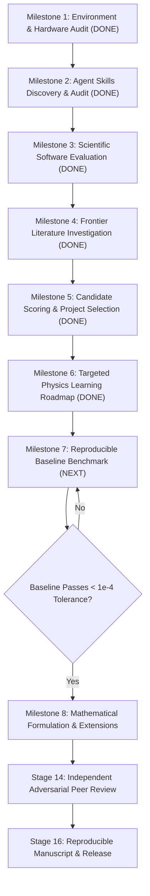

# RESEARCH ROADMAP — Project Frontier

## 1. Multi-Stage Laboratory Execution Plan

---

## 2. First-Month Research Schedule (Weeks 1–4)

### Week 1: Baseline Reproduction & Physics Module 1–2 (Milestone 7)
- **Software Setup:** Provision isolated Python 3.12 environment in `.venv` via `uv` with `numpy`, `scipy`, `sympy`, `astropy`, `jax`, `camb`, `cobaya`, `getdist`, and `matplotlib`. Install system compilers (`cmake`, `gcc`/`gfortran`) via Homebrew only if compiling `CLASS`/`hi_class` from C source.
- **Physics Learning (Modules 1 & 2):** Master spatially flat FLRW geometry, Friedmann equations, comoving sound horizon $r_d(z_{\mathrm{drag}})$, BAO observables ($D_M/r_d, D_H/r_d, D_V/r_d$), and the CPL equation of state $w(a) = w_0 + w_a(1-a)$.
- **Executable Benchmark (`BM-01`):**
  1. Symbolically derive $E(z) = H(z)/H_0$ and $\partial E(z)/\partial \theta_i$ in `SymPy`.
  2. Compute $D_M(z)/r_d$ and $D_H(z)/r_d$ across the 7 DESI DR2 effective redshift bins ($z \in [0.295, 2.33]$) using both `CAMB` and an independent `JAX`/`SciPy` quadrature solver.
  3. Cross-validate agreement to $< 10^{-5}$ relative error (background) and $< 10^{-4}$ (CMB acoustic scale $\theta_*$ and linear growth factor $D_+(z)$).
  4. Reproduce the DESI DR2 BAO + Planck compressed likelihood + Pantheon+ $(w_0, w_a)$ confidence contours from `arXiv:2503.14738`.

### Week 2: Horndeski / EFT of Dark Energy Formulation & Stability Boundaries (Milestone 8A)
- **Physics Learning (Module 3):** Study the Gubitosi-Piazza-Vernizzi EFT action and the Bellini-Sawicki $\alpha$-basis ($\alpha_M, \alpha_K, \alpha_B, \alpha_T$).
- **Symbolic Derivation:** Derive the exact no-ghost condition $Q_s = \frac{2 M_*^2 D}{(2 - \alpha_B)^2} > 0$ (where $D = \alpha_K + \frac{3}{2}\alpha_B^2$) and scalar sound speed squared $c_s^2 > 0$ in `SymPy`.
- **Stability Map Construction:** Map the $(w_0, w_a)$ plane into regions of:
  1. Quintessence stability ($w(z) > -1$, $\alpha_B = 0$ allowed).
  2. Phantom-crossing instability in unbraided scalar-tensor theories ($\alpha_B = 0 \implies D \le 0$ or $c_s^2 < 0$).
  3. Braided Horndeski stability ($\alpha_B \neq 0$, $D > 0, c_s^2 > 0, c_T^2 = 1$).

### Week 3: Prior-Volume, Basis-Sensitivity, & Profile Likelihood Experiments (Milestone 8B)
- **Physics Learning (Module 4):** Master Fisher information geometry, Jeffreys/physical prior transformations, profile likelihoods (frequentist, prior-independent) vs. Bayesian marginal posteriors, and AIC/BIC/deviance information criteria.
- **Computational Experiments (`EXP-01` to `EXP-03`):**
  - `EXP-01`: Compare Bayesian posteriors vs. frequentist profile likelihoods in $(w_0, w_a)$ when enforcing physical Horndeski stability priors ($D > 0, 0 < c_s^2 \le 1$) across redshift $z \in [0, 1100]$.
  - `EXP-02`: Replace the linear CPL expansion with orthogonal Chebyshev and Padé rational approximations of $w(a)$ and $\rho_{\mathrm{DE}}(a)/\rho_{\mathrm{DE},0}$ to measure basis-induced bias on phantom crossing.
  - `EXP-03`: Inject synthetic $\Lambda$CDM and braided-Horndeski mock datasets matching DESI DR2 covariance matrices to quantify false-positive phantom-crossing rates under CPL fitting.

### Week 4: Observational Cross-Checks & Adversarial Peer Review (Stage 13 & Stage 14)
- **Observational Confrontation:** Evaluate joint constraints and tension metrics across DESI DR2 BAO, Planck PR4 / ACT DR6 compressed CMB + lensing, and three SNe Ia compilations (Pantheon+, Union3, DES-SN5YR), including redshift-space distortion $f\sigma_8(z)$ predictions where braided Horndeski ($\alpha_B \neq 0$) modifies the effective gravitational coupling $G_{\mathrm{eff}}(k,a)/G_N$.
- **Independent Adversarial Audit:** Invoke an isolated Reviewer Subagent (`06-independent-review/peer-review/ADVERSARIAL_REVIEW_PROTOCOL.md`) to attempt falsification of all numerical and theoretical claims.
- **Artifact & Status Update:** Archive all chains, plots, unit tests, and review findings; update `RESEARCH_STATUS.md`.
